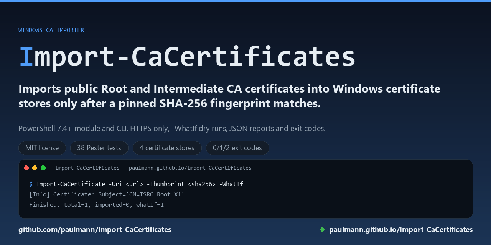

# Import-CaCertificates

**Import-CaCertificates** सार्वजनिक रूट और इंटरमीडिएट CA प्रमाणपत्रों को Windows
प्रमाणपत्र स्टोर में तभी आयात करता है जब हर प्रमाणपत्र पहले से तय SHA-256 फ़िंगरप्रिंट
से मेल खाता हो। यह PowerShell 7.4+ के लिए एक मॉड्यूल है, उन Windows सर्वरों के लिए
जिन्हें किसी डाउनलोड के बजाय किसी खास CA श्रृंखला पर भरोसा करना होता है।

[](https://github.com/paulmann/Import-CaCertificates/releases/latest)
[](https://learn.microsoft.com/powershell/)
[](https://www.microsoft.com/windows/)
[](LICENSE)

<!-- md-i18n:switcher -->
**यह दस्तावेज़ पढ़ें:** [English](README.md) · [Deutsch](README.de.md) · [中文](README.zh.md) · **हिन्दी** · [Español](README.es.md) · [Русский](README.ru.md)

<p align="center"></p>

[Wiki](https://github.com/paulmann/Import-CaCertificates/wiki) · [दस्तावेज़ साइट](https://paulmann.github.io/Import-CaCertificates/) · [रिलीज़](https://github.com/paulmann/Import-CaCertificates/releases) ·
[इश्यूज़](https://github.com/paulmann/Import-CaCertificates/issues) · [सुरक्षा](SECURITY.md) · [एजेंट के लिए](AGENTS.md)

## विषय-सूची

- [1. अवलोकन](#1-अवलोकन)
- [2. 2.0.0 में क्या बदला](#2-200-में-क्या-बदला)
- [3. विशेषताएँ](#3-विशेषताएँ)
- [4. सुरक्षा मॉडल](#4-सुरक्षा-मॉडल)
- [5. आवश्यकताएँ](#5-आवश्यकताएँ)
- [6. इंस्टॉलेशन](#6-इंस्टॉलेशन)
- [7. त्वरित शुरुआत](#7-त्वरित-शुरुआत)
- [8. उपयोग के उदाहरण](#8-उपयोग-के-उदाहरण)
- [9. पैरामीटर](#9-पैरामीटर)
- [10. आयात परिणाम और एक्ज़िट कोड](#10-आयात-परिणाम-और-एक्ज़िट-कोड)
- [11. 1.x से माइग्रेशन](#11-1x-से-माइग्रेशन)
- [12. समस्या निवारण](#12-समस्या-निवारण)
- [13. विकास](#13-विकास)
- [14. लाइसेंस और सहायता](#14-लाइसेंस-और-सहायता)
- [15. दस्तावेज़ीकरण](#15-दस्तावेज़ीकरण)

***

## 1. अवलोकन

**Import-CaCertificates** सार्वजनिक CA प्रमाणपत्रों (रूट और इंटरमीडिएट) को Windows
प्रमाणपत्र स्टोर में आयात करता है। यह उपकरण उन सर्वरों के लिए है जो सख्त फ़ायरवॉल के पीछे
हैं और उन परिनियोजनों के लिए जिन्हें किसी विशेष CA श्रृंखला पर भरोसा करना होता है —
जैसे hMailServer, Windows पर Exim, IIS या किसी आंतरिक कॉर्पोरेट PKI के लिए।

दायरा जानबूझकर सीमित है: यह उपकरण सार्वजनिक प्रमाणपत्र डाउनलोड या पढ़ता है, जाँचता है
कि वे अपेक्षित प्रमाणपत्र ही हैं, और उन्हें `LocalMachine` या `CurrentUser` स्टोर में
आयात करता है। यह प्रमाणपत्र माँगता, नवीनीकृत, बैकअप, सूचीबद्ध या हटाता नहीं है और
निजी कुंजियाँ कभी आयात नहीं करता।

रूट CA आयात करना पूरी मशीन के लिए भरोसे का निर्णय है। इसलिए संस्करण 2.0.0 हर आयात किए
जाने वाले प्रमाणपत्र के लिए अपेक्षित SHA-256 फ़िंगरप्रिंट अनिवार्य करता है और उसके
बिना रूट CA आयात से इंकार करता है, जब तक स्पष्ट रूप से `-AllowUnverifiedRoot` न दिया
जाए।

## 2. 2.0.0 में क्या बदला

संस्करण 2.0.0 सुरक्षा पर केंद्रित पुनर्लेखन है। कमांड का व्यवहार जानबूझकर बदला गया है;
अपग्रेड से पहले [CHANGELOG.md](CHANGELOG.md) और
[1.x से माइग्रेशन](#11-1x-से-माइग्रेशन) पढ़ें।

- एकल स्क्रिप्ट अब एक मॉड्यूल (`Import-CaCertificate`) और एक पतला CLI रैपर है।
- रूट CA आयात के लिए पिन किया गया SHA-256 फ़िंगरप्रिंट आवश्यक है; केवल `-RootUrl`
  वाला पुराना प्रवाह चुपचाप भरोसा करने के बजाय अस्वीकार कर दिया जाता है।
- सादा HTTP URL, PFX/P12 फ़ाइलें और निजी कुंजी वाली फ़ाइलें अस्वीकार की जाती हैं।
- प्रमाणपत्र सत्यापित किए जाते हैं (वैधता अवधि, CA भूमिका, Key Usage, हस्ताक्षर एल्गोरिदम),
  और रूट/इंटरमीडिएट जोड़ी का आयात से पहले श्रृंखला-सत्यापन होता है।
- बहु-प्रमाणपत्र PEM बंडल, स्थानीय फ़ाइलें और निर्देशिकाएँ समर्थित हैं।
- डुप्लिकेट हटाना SHA-256 फ़िंगरप्रिंट पर आधारित है (SHA-1 फ़िंगरप्रिंट रिपोर्ट होता है,
  पर वह पहचान की जाँच नहीं है)।
- संरचित परिणाम (`-PassThru`), JSON रिपोर्ट (`-Json`), लॉग फ़ाइलें (`-LogFile`),
  एक्ज़िट कोड और Pester/PSScriptAnalyzer CI जोड़े गए।

## 3. विशेषताएँ

- **स्पष्ट भरोसा एंकरिंग**: हर आयातित प्रमाणपत्र को `-Thumbprint` में दिए गए अपेक्षित
  SHA-256 फ़िंगरप्रिंट से मेल खाना चाहिए।
- **रूट CA के लिए सुरक्षित डिफ़ॉल्ट**: फ़िंगरप्रिंट के बिना रूट CA आयात अस्वीकार होता है;
  `-AllowUnverifiedRoot` स्पष्ट और स्पष्ट रूप से रिपोर्ट किया जाने वाला अपवाद है।
- **केवल HTTPS**: `http://` URL किसी भी अनुरोध से पहले अस्वीकार कर दिए जाते हैं।
- **केवल सार्वजनिक प्रमाणपत्र**: PFX/P12 फ़ाइलें और निजी कुंजी वाली कोई भी फ़ाइल
  अस्वीकार की जाती है।
- **सत्यापन**: X.509 पार्सिंग, `NotBefore`/`NotAfter`, Basic Constraints `CA=true`,
  Key Usage `keyCertSign`, टूटे हुए हस्ताक्षर एल्गोरिदम (MD2/MD5) और कमज़ोर कुंजी आकार।
- **श्रृंखला सत्यापन**: जब रूट और इंटरमीडिएट एक ही बैच में आते हैं, तो इंटरमीडिएट को
  दिए गए रूट तक श्रृंखला बनानी होती है (`-SkipChainValidation` इसे बंद करता है)।
- **लचीला इनपुट**: HTTPS URL, स्थानीय PEM/DER फ़ाइल, base64 DER, बहु-प्रमाणपत्र PEM
  बंडल या प्रमाणपत्र फ़ाइलों वाली निर्देशिका।
- **इडेम्पोटेंट स्टोर लेखन**: समान SHA-256 फ़िंगरप्रिंट वाला प्रमाणपत्र छोड़ दिया जाता
  है; `-Force` मौजूदा प्रति को बदलता है पर सत्यापन कभी नहीं छोड़ता।
- **ऑटोमेशन के अनुकूल**: `-WhatIf`, `-Confirm`, `-PassThru`, `-Json`, `-LogFile`,
  `-LogLevel` और अलग-अलग एक्ज़िट कोड।
- **Windows स्टोर**: `LocalMachine` (डिफ़ॉल्ट, व्यवस्थापक अधिकार आवश्यक) और
  `CurrentUser`, तथा `Root`, `CA`, `AuthRoot` और `TrustedPeople` स्टोर।

## 4. सुरक्षा मॉडल

पूरा खतरा मॉडल [docs/SECURITY-MODEL.md](docs/SECURITY-MODEL.md) में है। संक्षेप में:

1. डाउनलोड के लिए **केवल HTTPS** स्वीकार किया जाता है।
2. हर आयातित प्रमाणपत्र के लिए **अपेक्षित SHA-256 फ़िंगरप्रिंट अनिवार्य** है। रूट CA के
   लिए यह अनिवार्य है, जब तक स्पष्ट रूप से `-AllowUnverifiedRoot` न दिया जाए।
3. **किसी भी स्टोर लेखन से पहले प्रमाणपत्र सत्यापित होता है**: X.509 के रूप में पार्स,
   वैधता अवधि के भीतर, CA के रूप में चिह्नित, प्रमाणपत्र हस्ताक्षरित करने की अनुमति और
   स्वीकार्य एल्गोरिदम से हस्ताक्षरित।
4. **प्रमाणपत्र निजी कुंजी नहीं है**: निजी कुंजी वाली फ़ाइलें और PFX/P12 कंटेनर
   अस्वीकार किए जाते हैं।
5. **पुष्टि डिफ़ॉल्ट है**: `ConfirmImpact = High` का अर्थ है कि इंटरैक्टिव रन लिखने से
   पहले पूछता है; गैर-इंटरैक्टिव ऑटोमेशन को `-Confirm:$false` देना होगा।
6. **कोई टेलीमेट्री नहीं, कोई छिपा नेटवर्क एक्सेस नहीं**: एकमात्र नेटवर्क अनुरोध आपके
   द्वारा दिए गए `-Uri` हैं।

पिन किया गया फ़िंगरप्रिंट बदले गए डाउनलोड, समझौता किए गए मिरर या गलत फ़ाइल से बचाता
है। यह उस CA से नहीं बचाता जिसने वैध रूप से कोई दूसरा रूट जारी किया हो — इसलिए
फ़िंगरप्रिंट CA के प्रकाशित पृष्ठ या आपके PKI दस्तावेज़ से लेना चाहिए, उसी URL से नहीं
जिससे आप फ़ाइल डाउनलोड कर रहे हैं।

## 5. आवश्यकताएँ

| आवश्यकता | विवरण |
|---|---|
| ऑपरेटिंग सिस्टम | Windows 10 (1607 या बाद का), Windows 11, Windows Server 2012 R2 या बाद का |
| PowerShell | 7.4 या बाद का (`pwsh`)। Windows PowerShell 5.1 समर्थित नहीं है। |
| अनुमतियाँ | `-StoreLocation LocalMachine` के लिए स्थानीय व्यवस्थापक; `-StoreLocation CurrentUser` के लिए एलिवेशन आवश्यक नहीं |
| नेटवर्क | प्रत्येक `-Uri` होस्ट तक HTTPS पहुँच; `-Path` के साथ आवश्यक नहीं |
| Windows 7 / 8.1 | समर्थित नहीं: PowerShell 7 वहाँ इंस्टॉल नहीं होता। 1.x ने ऐसा समर्थन दावा किया जो वास्तव में नहीं था। |

CI में `windows-latest` पर PowerShell 7.x और Pester 5.7.1 के साथ, तथा स्थानीय रूप से
Windows 10/11 पर PowerShell 7.6 के साथ परीक्षण किया गया। अन्य संयोजन काम करने चाहिए,
पर CI में कवर नहीं हैं।

## 6. इंस्टॉलेशन

### रिलीज़ से (अनुशंसित)

[रिलीज़ पृष्ठ](https://github.com/paulmann/Import-CaCertificates/releases/latest) से नवीनतम
`Import-CaCertificates-<version>.zip` और `SHA256SUMS.txt` डाउनलोड करें, संग्रह सत्यापित
करें और उसे किसी टूल निर्देशिका जैसे `C:\Tools\Import-CaCertificates` में निकालें:

```powershell
$expected = (Select-String -Path .\SHA256SUMS.txt -Pattern '\.zip$').Line.Split(' ')[0]
(Get-FileHash -Algorithm SHA256 -LiteralPath .\Import-CaCertificates-2.0.1.zip).Hash -eq $expected
Expand-Archive -LiteralPath .\Import-CaCertificates-2.0.1.zip -DestinationPath C:\Tools\Import-CaCertificates
```

संग्रह में मॉड्यूल (`src/Import-CaCertificates`), CLI रैपर, दस्तावेज़ और लाइसेंस हैं।
रैपर अपने स्थान के सापेक्ष मॉड्यूल ढूँढता है, इसलिए निकाली गई निर्देशिका को पूरी तरह
स्थानांतरित किया जा सकता है।

### स्रोत से

```powershell
git clone https://github.com/paulmann/Import-CaCertificates.git
cd Import-CaCertificates
```

अभी कोई इंस्टॉलर और कोई PSGallery पैकेज नहीं है। मॉड्यूल सीधे आयात करें:

```powershell
Import-Module .\src\Import-CaCertificates\Import-CaCertificates.psd1
Get-Command Import-CaCertificate
```

### सत्यापन

```powershell
Import-Module .\src\Import-CaCertificates\Import-CaCertificates.psd1
Get-Help Import-CaCertificate -Full
```

## 7. त्वरित शुरुआत

**चरण 1 — CA के प्रकाशित पृष्ठ से अपेक्षित SHA-256 फ़िंगरप्रिंट प्राप्त करें।** यदि CA
प्रमाणपत्र फ़ाइल प्रकाशित करता है, तो फ़िंगरप्रिंट स्वयं गणना करें और उसकी तुलना CA द्वारा
कहीं और प्रकाशित मान से करें:

```powershell
$cert = [System.Security.Cryptography.X509Certificates.X509Certificate2]::new('C:\certs\ca.pem')
[Convert]::ToHexString([System.Security.Cryptography.SHA256]::HashData($cert.RawData))
```

**चरण 2 — ड्राई रन।** `-WhatIf` डाउनलोड, पार्स, सत्यापन और योजना प्रिंट करता है; स्टोर
में कुछ नहीं लिखता:

```powershell
Import-CaCertificate -Uri 'https://letsencrypt.org/certs/isrgrootx1.pem' `
    -Thumbprint '96BCEC06264976F37460779ACF28C5A7CFE8A3C0AAE11A8FFCEE05C0BDDF08C6' `
    -WhatIf -Confirm:$false
```

`96BCEC06…` Let's Encrypt द्वारा प्रकाशित ISRG Root X1 का SHA-256 फ़िंगरप्रिंट है; यह
यहाँ काम करने वाले उदाहरण के रूप में दिया गया है, किसी CA पर भरोसा करने की सिफ़ारिश के
रूप में नहीं।

**चरण 3 — आयात।** `-Confirm:$false` के बिना इंटरैक्टिव सत्र हर स्टोर लेखन से पहले
पुष्टि माँगता है। ऑटोमेशन को `-Confirm:$false` देना होगा:

```powershell
Import-CaCertificate -Uri 'https://letsencrypt.org/certs/isrgrootx1.pem' `
    -Thumbprint '96BCEC06264976F37460779ACF28C5A7CFE8A3C0AAE11A8FFCEE05C0BDDF08C6' `
    -Confirm:$false -PassThru
```

**चरण 4 — स्टोर जाँचें।**

```powershell
Get-ChildItem Cert:\LocalMachine\Root | Where-Object Subject -match 'ISRG Root X1'
```

जिस सेवा ने अज्ञात CA की सूचना दी थी (जैसे hMailServer), उसे पुनः आरंभ करें ताकि वह
मशीन के भरोसा स्टोर को फिर से पढ़े।

## 8. उपयोग के उदाहरण

### स्थानीय फ़ाइल से रूट CA आयात करें

```powershell
Import-CaCertificate -Path 'C:\certs\root.pem' `
    -Thumbprint '96BCEC06264976F37460779ACF28C5A7CFE8A3C0AAE11A8FFCEE05C0BDDF08C6' `
    -StoreLocation LocalMachine -Confirm:$false
```

### केवल इंटरमीडिएट CA आयात करें

गैर-स्व-हस्ताक्षरित CA प्रमाणपत्र स्वतः `LocalMachine\CA` में जाता है:

```powershell
Import-CaCertificate -Path 'C:\certs\intermediate.pem' -Thumbprint '<sha256>' -Confirm:$false
```

### बंडल आयात करें, रूट छोड़ें

बहु-प्रमाणपत्र PEM में एक रूट और एक या अधिक इंटरमीडिएट हो सकते हैं। आप जो भी आयात
करें उसका फ़िंगरप्रिंट पिन करें; `-NoRootImport` रूट छोड़ देता है:

```powershell
Import-CaCertificate -Path 'C:\certs\chain.pem' `
    -Thumbprint '<sha256-intermediate-1>', '<sha256-intermediate-2>' `
    -NoRootImport -Confirm:$false
```

### प्रमाणपत्रों की निर्देशिका आयात करें

```powershell
Import-CaCertificate -Path 'C:\certs\corporate-cas' -Thumbprint '<sha256-1>', '<sha256-2>' -WhatIf -Confirm:$false
```

### JSON रिपोर्ट के साथ ऑटोमेशन

```powershell
$report = Import-CaCertificate -Uri 'https://ca.example.com/root.pem' `
    -Thumbprint '0123...' -Confirm:$false -Json
$report | Out-File -LiteralPath 'C:\logs\ca-import.json' -Encoding utf8NoBOM
```

`-Json` एक JSON लिफ़ाफ़ा (`Version`, `Timestamp`, `Summary`, `Results`) लौटाता है।
`-Json` के साथ सूचना लॉग दबा दिया जाता है, जब तक `-LogLevel` स्पष्ट रूप से न दिया जाए,
इसलिए stdout में केवल JSON दस्तावेज़ रहता है।

### फ़ाइल में लॉग करें

```powershell
Import-CaCertificate -Path 'C:\certs\root.pem' -Thumbprint '<sha256>' `
    -LogFile 'C:\logs\ca-import.log' -LogLevel Verbose -Confirm:$false
```

### ऑफ़लाइन / एयर-गैप्ड होस्ट

1. किसी अन्य मशीन पर प्रमाणपत्र डाउनलोड करें और उसका फ़िंगरप्रिंट सत्यापित करें।
2. PEM/DER फ़ाइल (और उसका SHA-256) लक्ष्य होस्ट पर कॉपी करें।
3. `Import-CaCertificate -Path ... -Thumbprint ... -Confirm:$false` चलाएँ।

### मौजूदा प्रति बदलें

```powershell
Import-CaCertificate -Path 'C:\certs\root.pem' -Thumbprint '<sha256>' -Force -Confirm:$false
```

`-Force` समान SHA-256 फ़िंगरप्रिंट वाला प्रमाणपत्र बदलता है; यह फ़िंगरप्रिंट सत्यापन को
नहीं छोड़ता।

### आयात पूर्ववत करें

```powershell
Remove-Item -Path Cert:\LocalMachine\Root\<SHA-1-thumbprint>
Remove-Item -Path Cert:\LocalMachine\CA\<SHA-1-thumbprint>
```

प्रत्येक परिणाम ऑब्जेक्ट `ThumbprintSha1` (`certmgr.msc` / `certutil` के लिए) और
`ThumbprintSha256` (पहचान की जाँच) रिपोर्ट करता है।

अधिक परिदृश्य: [docs/EXAMPLES.md](docs/EXAMPLES.md).

## 9. पैरामीटर

### मॉड्यूल कमांड `Import-CaCertificate`

| पैरामीटर | प्रकार | डिफ़ॉल्ट | विवरण |
|---|---|---|---|
| `-Uri` | string[] | — | प्रमाणपत्र फ़ाइलों के HTTPS URL (PEM, DER, base64 DER या बहु-प्रमाणपत्र PEM बंडल)। `ByUri` पैरामीटर सेट में अनिवार्य। |
| `-Path` | string[] | — | स्थानीय प्रमाणपत्र फ़ाइलें या `.cer/.crt/.pem/.der/.cert` फ़ाइलों वाली निर्देशिकाएँ। `ByPath` पैरामीटर सेट में अनिवार्य। |
| `-Thumbprint` | string[] | — | अपेक्षित SHA-256 फ़िंगरप्रिंट, 64 हेक्स अक्षर; रिक्त स्थान, कोलन और हाइफ़न अनदेखा किए जाते हैं। हर आयातित प्रमाणपत्र को इनमें से किसी एक मान से मेल खाना चाहिए। |
| `-StoreLocation` | string | `LocalMachine` | `LocalMachine` (एलिवेशन आवश्यक) या `CurrentUser`। |
| `-StoreName` | string | स्वतः | `Root`, `CA`, `AuthRoot` या `TrustedPeople`। इसके बिना स्व-हस्ताक्षरित CA `Root` में और गैर-स्व-हस्ताक्षरित CA `CA` में जाता है। |
| `-NoRootImport` | switch | बंद | रूट CA प्रमाणपत्रों को आयात करने के बजाय छोड़ें। |
| `-AllowUnverifiedRoot` | switch | बंद | `-Thumbprint` के बिना रूट CA आयात की अनुमति दें। यह स्पष्ट भरोसा निर्णय है; चेतावनी लॉग होती है और रन को असत्यापित बताया जाता है। |
| `-RequireConfirmation` | switch | बंद | `ShouldProcess` के अतिरिक्त हर प्रमाणपत्र के लिए इंटरैक्टिव हाँ/नहीं पुष्टि माँगें। गैर-इंटरैक्टिव सत्र में उपयोग नहीं हो सकता। |
| `-Force` | switch | बंद | समान SHA-256 फ़िंगरप्रिंट वाला मौजूदा प्रमाणपत्र बदलें। |
| `-PassThru` | switch | बंद | प्रति प्रमाणपत्र एक परिणाम ऑब्जेक्ट लौटाएँ। |
| `-Json` | switch | बंद | एक JSON लिफ़ाफ़ा (`Version`, `Timestamp`, `Summary`, `Results`) लौटाएँ। |
| `-LogLevel` | string | `Info` | `None`, `Error`, `Warning`, `Info` या `Verbose`। |
| `-LogFile` | string | — | इस फ़ाइल में लॉग पंक्तियाँ (UTF-8, BOM रहित) जोड़ें। |
| `-KeepTempFiles` | switch | बंद | अस्थायी निर्देशिका में डाउनलोड की गई फ़ाइलें रखें। |
| `-TempPath` | string | `$env:TEMP` | अद्वितीय अस्थायी डाउनलोड निर्देशिका के लिए मूल निर्देशिका, जिसे बाद में हटा दिया जाता है। मौजूदा फ़ाइलें कभी नहीं हटाई जातीं। |
| `-SkipChainValidation` | switch | बंद | दिए गए रूट और इंटरमीडिएट के बीच हस्ताक्षर-श्रृंखला जाँच छोड़ें। |
| `-WhatIf` / `-Confirm` | सामान्य | — | मानक `ShouldProcess` व्यवहार। |

### CLI रैपर `Import-CaCertificates.ps1`

रैपर वही पैरामीटर स्वीकार करता है, साथ में दो अप्रचलित संगतता स्विच जो `-Uri` पर
मैप होते हैं:

| पैरामीटर | स्थिति | विवरण |
|---|---|---|
| `-RootUrl` | अप्रचलित | रूट CA का HTTPS URL। `-Uri` का उपयोग करें। |
| `-IntermediateUrl` | अप्रचलित | इंटरमीडिएट CA का HTTPS URL। `-Uri` का उपयोग करें। |
| `-KeepFiles` | उपनाम | `-KeepTempFiles` का उपनाम (1.x README में यह नाम इस्तेमाल हुआ था)। |

रैपर को निकाले गए रिलीज़ (या रिपॉज़िटरी रूट) से शुरू करना चाहिए; यह अपने स्थान के सापेक्ष
`src/Import-CaCertificates/Import-CaCertificates.psd1` लोड करता है।

## 10. आयात परिणाम और एक्ज़िट कोड

हर प्रमाणपत्र निम्नलिखित में से एक स्थिति पाता है:

| स्थिति | अर्थ |
|---|---|
| `Imported` | प्रमाणपत्र लक्ष्य स्टोर में लिखा गया और वापस पढ़कर सत्यापित किया गया। |
| `Replaced` | समान SHA-256 फ़िंगरप्रिंट वाला मौजूदा प्रमाणपत्र बदला गया (`-Force`)। |
| `AlreadyPresent` | वही प्रमाणपत्र पहले से स्टोर में है; कुछ नहीं लिखा गया। |
| `Skipped` | प्रमाणपत्र नीति द्वारा बाहर रखा गया (`-NoRootImport`)। |
| `WhatIf` | ड्राई रन: प्रमाणपत्र सभी जाँचों में पास हुआ पर लिखा नहीं गया। |
| `Declined` | इंटरैक्टिव पुष्टि का उत्तर "नहीं" दिया गया। |

CLI एक्ज़िट कोड:

| कोड | अर्थ |
|---|---|
| `0` | रन समाप्त हुआ (ड्राई रन, छोड़े गए डुप्लिकेट और अस्वीकृत पुष्टि सहित)। इसे "आयातित" मानने से पहले स्टोर जाँचें। |
| `1` | परिचालन विफलता: डाउनलोड, फ़ाइल सिस्टम, स्टोर एक्सेस, मॉड्यूल नहीं मिला। |
| `2` | सुरक्षा या सत्यापन इंकार: सादा HTTP, अनुपस्थित/बेमेल फ़िंगरप्रिंट, CA नहीं, समाप्त, निजी कुंजी, PFX, श्रृंखला बेमेल, `LocalMachine` के लिए एलिवेशन नहीं। |

## 11. 1.x से माइग्रेशन

| 1.x | 2.0.0 |
|---|---|
| `-RootUrl` और `-IntermediateUrl` | `-Uri` (सूची); अप्रचलित नाम CLI रैपर में अभी भी काम करते हैं और चेतावनी लॉग करते हैं। |
| कोई फ़िंगरप्रिंट जाँच नहीं | हर प्रमाणपत्र के लिए `-Thumbprint` अनिवार्य है; इसके बिना रूट CA आयात अस्वीकार होता है, जब तक `-AllowUnverifiedRoot` उपयोग न हो। |
| `-KeepFiles` (दस्तावेज़) / `-KeepTempFiles` (कार्यान्वयन) | `-KeepTempFiles`; `-KeepFiles` एक उपनाम है। |
| रन के बाद `-TempPath` हटा दिया जाता था | `-TempPath` के अंतर्गत अद्वितीय उपनिर्देशिका बनाई और हटाई जाती है; मौजूदा फ़ाइलें नहीं छेड़ी जातीं। |
| प्रति URL एक प्रमाणपत्र | बहु-प्रमाणपत्र PEM बंडल, निर्देशिकाएँ और `-Path` समर्थित हैं। |
| रूट/इंटरमीडिएट पैरामीटर से चुने जाते थे | प्रमाणपत्र प्रकार से चुने जाते हैं, या `-StoreName` से बाध्य किए जाते हैं। |
| Windows 7 / Server 2012 R2 का दावा | Windows 10 1607+/11, Windows Server 2012 R2+ के साथ PowerShell 7.4+। Windows 7 समर्थित नहीं है। |
| केवल कंसोल लॉग | `-PassThru`, `-Json`, `-LogFile`, `-LogLevel` और एक्ज़िट कोड। |

## 12. समस्या निवारण

| लक्षण | कारण | कार्रवाई |
|---|---|---|
| `Root CA import ... requires an expected SHA-256 fingerprint` | `-Thumbprint` के बिना रूट CA आयात | CA के प्रकाशित पृष्ठ से फ़िंगरप्रिंट लें और दें। |
| `Invalid -Thumbprint value ... SHA-1 thumbprint` | मान 40-हेक्स SHA-1 फ़िंगरप्रिंट है | SHA-256 फ़िंगरप्रिंट (64 हेक्स अक्षर) की गणना करें। |
| `does not match any expected -Thumbprint value` | गलत प्रमाणपत्र या गलत फ़िंगरप्रिंट | subject, issuer और प्रिंट किए गए SHA-256 की स्रोत से तुलना करें। |
| `Only https:// URLs are allowed` | `http://` URL | CA के HTTPS URL का उपयोग करें; जाँच को बायपास न करें। |
| `contains a private key` / `PFX/P12` | फ़ाइल में निजी कुंजी सामग्री है | सार्वजनिक प्रमाणपत्र निर्यात करें (`Export-Certificate -Type CERT`) और उसे आयात करें। |
| `failed validation: the certificate is expired` | प्रमाणपत्र समाप्त हो गया | CA से वर्तमान प्रमाणपत्र प्राप्त करें। |
| `does not chain to the supplied root certificate(s)` | रूट और इंटरमीडिएट एक साथ नहीं हैं | मेल खाती जोड़ी डाउनलोड करें, या केवल आवश्यक प्रमाणपत्र आयात करें। |
| `LocalMachine certificate stores require an elevated session` | व्यवस्थापक के रूप में नहीं चल रहा | एलिवेटेड `pwsh` शुरू करें या `-StoreLocation CurrentUser` उपयोग करें। |
| `NonInteractive mode` त्रुटि | ऑटोमेशन में डिफ़ॉल्ट पुष्टि संकेत | `-Confirm:$false` दें (ड्राई रन के लिए `-WhatIf` भी)। |
| आयात के बाद भी `Unknown CA` | सेवा ने अपनी श्रृंखला कैश की है | सेवा पुनः आरंभ करें। |

## 13. विकास

```powershell
# Tests (Pester 5.7.1 and 6.x are both supported)
Install-Module Pester -RequiredVersion 5.7.1 -Force -Scope CurrentUser
Invoke-Pester -Path .\tests -Output Detailed

# Static analysis (runs in CI as well)
Install-Module PSScriptAnalyzer -Force -Scope CurrentUser
Invoke-ScriptAnalyzer -Path . -Recurse -Settings .\PSScriptAnalyzerSettings.psd1

# Build a release archive and checksums
.\tools\New-Release.ps1 -Version v2.0.1 -OutputDirectory .\out
```

इंटीग्रेशन परीक्षण सशर्त हैं: नेटवर्क परीक्षण तब चलते हैं जब `$env:CI` सेट हो, और
`LocalMachine` परीक्षण केवल एलिवेटेड CI रनर पर। देखें
[tests/Import-CaCertificates.Integration.Tests.ps1](tests/Import-CaCertificates.Integration.Tests.ps1).

CI हर push और pull request पर PSScriptAnalyzer और Pester चलाता है; `v*` टैग push करने पर
संग्रह बनाया जाता, उसका SHA-256 सत्यापित किया जाता और GitHub रिलीज़ प्रकाशित की जाती है।

## 14. लाइसेंस और सहायता

### लाइसेंस

यह परियोजना **MIT लाइसेंस** के अंतर्गत लाइसेंस प्राप्त है — देखें [LICENSE](LICENSE)। कॉपीराइट सूचना और अनुमति सूचना बनाए रखने पर आप इसका उपयोग, संशोधन, वितरण और प्रतियाँ बेच सकते हैं।

2.0.0 और उससे पहले के संस्करण PolyForm Noncommercial License 1.0.0 के अंतर्गत प्रकाशित हुए थे; 2.0.1 से MIT लागू है।

### लेखक

Mikhail Deynekin — [GitHub: paulmann](https://github.com/paulmann) —
paulmann@users.noreply.github.com

### सुरक्षा रिपोर्ट

सुरक्षा समस्याओं के लिए कृपया सार्वजनिक issue न खोलें। देखें [SECURITY.md](SECURITY.md)।

### परियोजना का समर्थन

यदि इस उपकरण ने आपकी प्रमाणपत्र समस्या हल की, तो अपने रनबुक में संस्करण और लिंक के साथ
इसका उल्लेख करें। स्वचालित रूप से star, fork या टिप्पणियाँ न बनाएँ।

## 15. दस्तावेज़ीकरण

| संसाधन | विवरण |
|---|---|
| [Wiki](https://github.com/paulmann/Import-CaCertificates/wiki) | इंस्टॉलेशन, पैरामीटर और समस्या निवारण लेख विकी पृष्ठों के रूप में। |
| [दस्तावेज़ साइट](https://paulmann.github.io/Import-CaCertificates/) | वही संदर्भ ब्राउज़ करने योग्य साइट के रूप में। |
| [रिलीज़](https://github.com/paulmann/Import-CaCertificates/releases) | संस्करण इतिहास, रिलीज़ नोट्स और चेकसम वाले संग्रह। |
| [उदाहरण](docs/EXAMPLES.md) | आम प्रमाणपत्र समस्याओं के लिए कार्य-केंद्रित परिदृश्य। |
| [सुरक्षा मॉडल](docs/SECURITY-MODEL.md) | खतरा मॉडल, गारंटी और फ़िंगरप्रिंट पिनिंग की सीमाएँ। |
| [एजेंट के लिए](AGENTS.md) | रिपॉज़िटरी मैप और स्वचालित एजेंट के लिए निर्देश। |
| [सुरक्षा नीति](SECURITY.md) | किसी भेद्यता की निजी रूप से रिपोर्ट कैसे करें। |
| [योगदान](CONTRIBUTING.md) | विकास प्रक्रिया, परीक्षण और pull request नियम। |
| [चेंजलॉग](CHANGELOG.md) | हर संस्करण में क्या बदला। |
