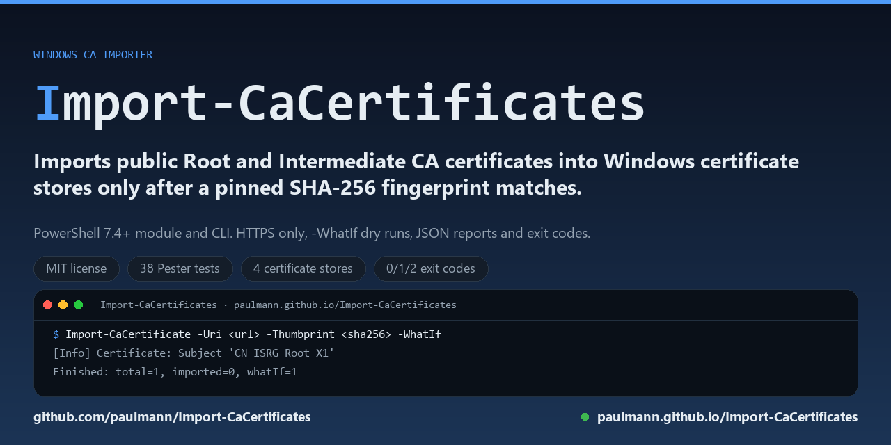

# Import-CaCertificates

**Import-CaCertificates** 在确认每个证书都与固定的 SHA-256 指纹匹配后，才将公共根 CA
和中间 CA 证书导入 Windows 证书存储。它是面向 PowerShell 7.4+ 的模块，适用于必须信任
特定 CA 链、而不是信任一次下载的 Windows 服务器。

[](https://github.com/paulmann/Import-CaCertificates/releases/latest)
[](https://learn.microsoft.com/powershell/)
[](https://www.microsoft.com/windows/)
[](LICENSE)

<!-- md-i18n:switcher -->
**阅读本文的其他语言版本：** [English](README.md) · [Deutsch](README.de.md) · **中文** · [हिन्दी](README.hi.md) · [Español](README.es.md) · [Русский](README.ru.md)

<p align="center"></p>

[Wiki](https://github.com/paulmann/Import-CaCertificates/wiki) · [文档站点](https://paulmann.github.io/Import-CaCertificates/) · [发布](https://github.com/paulmann/Import-CaCertificates/releases) ·
[问题](https://github.com/paulmann/Import-CaCertificates/issues) · [安全](SECURITY.md) · [面向代理](AGENTS.md)

## 目录

- [1. 概述](#1-概述)
- [2. 2.0.0 版本的变化](#2-200-版本的变化)
- [3. 功能](#3-功能)
- [4. 安全模型](#4-安全模型)
- [5. 系统要求](#5-系统要求)
- [6. 安装](#6-安装)
- [7. 快速开始](#7-快速开始)
- [8. 使用示例](#8-使用示例)
- [9. 参数](#9-参数)
- [10. 导入结果与退出代码](#10-导入结果与退出代码)
- [11. 从 1.x 迁移](#11-从-1x-迁移)
- [12. 故障排除](#12-故障排除)
- [13. 开发](#13-开发)
- [14. 许可证与支持](#14-许可证与支持)
- [15. 文档](#15-文档)

***

## 1. 概述

**Import-CaCertificates** 将公共 CA 证书（根证书和中间证书）导入 Windows 证书存储。
该工具面向位于严格防火墙之后的服务器，以及必须信任特定 CA 链的部署场景——例如
hMailServer、Windows 上的 Exim、IIS 或企业内部 PKI。

工具的范围有意保持狭窄：它下载或读取公共证书，验证它们正是你期望的证书，然后导入到
`LocalMachine` 或 `CurrentUser` 存储。它不申请、不续期、不备份、不枚举也不删除证书，
并且从不导入私钥。

导入根 CA 是对整台机器的信任决策。因此 2.0.0 版本要求为每个导入的证书提供预期的
SHA-256 指纹，并在缺少指纹时拒绝导入根 CA，除非显式使用 `-AllowUnverifiedRoot`。

## 2. 2.0.0 版本的变化

2.0.0 是一次以安全为中心的改写。命令的行为有意发生了变化；升级前请阅读
[CHANGELOG.md](CHANGELOG.md) 和[从 1.x 迁移](#11-从-1x-迁移)。

- 单个脚本变成了模块（`Import-CaCertificate`）加一个轻量 CLI 包装脚本。
- 根 CA 导入要求固定的 SHA-256 指纹；旧的仅使用 `-RootUrl` 的流程会被拒绝，而不是
  被默默信任。
- 纯 HTTP 地址、PFX/P12 文件以及包含私钥的文件都会被拒绝。
- 证书会被校验（有效期、CA 角色、Key Usage、签名算法），根证书/中间证书对在导入前
  会进行链校验。
- 支持多证书 PEM 包、本地文件和目录。
- 去重基于 SHA-256 指纹（仍会输出 SHA-1 指纹，但它不是身份校验依据）。
- 新增结构化结果（`-PassThru`）、JSON 报告（`-Json`）、日志文件（`-LogFile`）、退出
  代码以及 Pester/PSScriptAnalyzer CI。

## 3. 功能

- **显式信任锚定**：每个导入的证书都必须与 `-Thumbprint` 传入的预期 SHA-256 指纹
  匹配。
- **根 CA 的安全默认值**：没有指纹的根 CA 导入会被拒绝；`-AllowUnverifiedRoot` 是
  显式且会大声报告的例外。
- **仅限 HTTPS**：`http://` 地址在发出任何请求之前就被拒绝。
- **仅限公共证书**：PFX/P12 文件以及任何包含私钥的文件都会被拒绝。
- **校验**：X.509 解析、`NotBefore`/`NotAfter`、Basic Constraints `CA=true`、
  Key Usage `keyCertSign`、损坏的签名算法（MD2/MD5）以及过弱的密钥长度。
- **链校验**：当根证书与中间证书出现在同一批次时，中间证书必须能链接到所提供的
  根证书（可用 `-SkipChainValidation` 关闭）。
- **灵活的输入**：HTTPS 地址、本地 PEM/DER 文件、base64 DER、多证书 PEM 包或存放
  证书文件的目录。
- **幂等的存储写入**：具有相同 SHA-256 指纹的证书会被跳过；`-Force` 会替换现有副本，
  但绝不会跳过校验。
- **便于自动化**：`-WhatIf`、`-Confirm`、`-PassThru`、`-Json`、`-LogFile`、
  `-LogLevel` 以及可区分的退出代码。
- **Windows 存储**：`LocalMachine`（默认，需要管理员权限）和 `CurrentUser`，以及
  `Root`、`CA`、`AuthRoot`、`TrustedPeople` 存储。

## 4. 安全模型

完整的威胁模型见 [docs/SECURITY-MODEL.md](docs/SECURITY-MODEL.md)。简要版本：

1. 下载**只接受 HTTPS**。
2. 每个导入的证书都**必须提供预期的 SHA-256 指纹**。对于根 CA，除非显式传入
   `-AllowUnverifiedRoot`，否则该指纹是必填项。
3. **在写入任何存储之前先校验证书**：按 X.509 解析、处于有效期内、标记为 CA、允许
   签发证书，并且使用可接受的算法签名。
4. **证书不是私钥**：包含私钥的文件以及 PFX/P12 容器都会被拒绝。
5. **默认需要确认**：`ConfirmImpact = High` 表示交互式运行会在写入前询问；非交互式
   自动化必须传入 `-Confirm:$false`。
6. **没有遥测，也没有隐藏的网络访问**：唯一的网络请求就是你提供的 `-Uri`。

固定指纹可以防止下载被替换、镜像被攻破或拿到错误的文件。它不能防止 CA 合法地重新
签发了另一个根证书——因此指纹必须来自 CA 自己发布的页面或你的 PKI 文档，而不是你
下载文件的那个 URL。

## 5. 系统要求

| 要求 | 详情 |
|---|---|
| 操作系统 | Windows 10（1607 或更高）、Windows 11、Windows Server 2012 R2 或更高 |
| PowerShell | 7.4 或更高（`pwsh`）。不支持 Windows PowerShell 5.1。 |
| 权限 | `-StoreLocation LocalMachine` 需要本地管理员；`-StoreLocation CurrentUser` 无需提权 |
| 网络 | 可对每个 `-Uri` 主机进行 HTTPS 访问；使用 `-Path` 时不需要 |
| Windows 7 / 8.1 | 不支持：PowerShell 7 无法安装在这些系统上。1.x 曾声称支持，但实际并不支持。 |

已在 CI 的 `windows-latest` 上使用 PowerShell 7.x 和 Pester 5.7.1 验证，并在本地
Windows 10/11 + PowerShell 7.6 上验证。其他组合应当可用，但不在 CI 覆盖范围内。

## 6. 安装

### 从发布包安装（推荐）

从[发布页面](https://github.com/paulmann/Import-CaCertificates/releases/latest)下载最新的
`Import-CaCertificates-<version>.zip` 和 `SHA256SUMS.txt`，校验压缩包后解压到工具目录，
例如 `C:\Tools\Import-CaCertificates`：

```powershell
$expected = (Select-String -Path .\SHA256SUMS.txt -Pattern '\.zip$').Line.Split(' ')[0]
(Get-FileHash -Algorithm SHA256 -LiteralPath .\Import-CaCertificates-2.0.1.zip).Hash -eq $expected
Expand-Archive -LiteralPath .\Import-CaCertificates-2.0.1.zip -DestinationPath C:\Tools\Import-CaCertificates
```

压缩包包含模块（`src/Import-CaCertificates`）、CLI 包装脚本、文档和许可证。包装脚本
会相对自身位置查找模块，因此解压后的目录可以整体移动。

### 从源码安装

```powershell
git clone https://github.com/paulmann/Import-CaCertificates.git
cd Import-CaCertificates
```

目前没有安装程序，也没有 PSGallery 包。直接导入模块：

```powershell
Import-Module .\src\Import-CaCertificates\Import-CaCertificates.psd1
Get-Command Import-CaCertificate
```

### 验证

```powershell
Import-Module .\src\Import-CaCertificates\Import-CaCertificates.psd1
Get-Help Import-CaCertificate -Full
```

## 7. 快速开始

**第 1 步——从 CA 发布的页面获取预期的 SHA-256 指纹。** 如果 CA 发布了证书文件，请
自行计算指纹，并与 CA 在其他渠道公布的值进行比较：

```powershell
$cert = [System.Security.Cryptography.X509Certificates.X509Certificate2]::new('C:\certs\ca.pem')
[Convert]::ToHexString([System.Security.Cryptography.SHA256]::HashData($cert.RawData))
```

**第 2 步——试运行。** `-WhatIf` 会下载、解析、校验并打印计划；不写入存储：

```powershell
Import-CaCertificate -Uri 'https://letsencrypt.org/certs/isrgrootx1.pem' `
    -Thumbprint '96BCEC06264976F37460779ACF28C5A7CFE8A3C0AAE11A8FFCEE05C0BDDF08C6' `
    -WhatIf -Confirm:$false
```

`96BCEC06…` 是 Let's Encrypt 发布的 ISRG Root X1 的 SHA-256 指纹；此处仅作为可用
示例，不代表建议信任任何特定 CA。

**第 3 步——导入。** 不带 `-Confirm:$false` 时，交互式会话会在每次写入前请求确认。
自动化必须传入 `-Confirm:$false`：

```powershell
Import-CaCertificate -Uri 'https://letsencrypt.org/certs/isrgrootx1.pem' `
    -Thumbprint '96BCEC06264976F37460779ACF28C5A7CFE8A3C0AAE11A8FFCEE05C0BDDF08C6' `
    -Confirm:$false -PassThru
```

**第 4 步——检查存储。**

```powershell
Get-ChildItem Cert:\LocalMachine\Root | Where-Object Subject -match 'ISRG Root X1'
```

重启报告未知 CA 的服务（例如 hMailServer），使其重新读取机器的信任存储。

## 8. 使用示例

### 从本地文件导入根 CA

```powershell
Import-CaCertificate -Path 'C:\certs\root.pem' `
    -Thumbprint '96BCEC06264976F37460779ACF28C5A7CFE8A3C0AAE11A8FFCEE05C0BDDF08C6' `
    -StoreLocation LocalMachine -Confirm:$false
```

### 仅导入中间 CA

非自签名的 CA 证书会自动进入 `LocalMachine\CA`：

```powershell
Import-CaCertificate -Path 'C:\certs\intermediate.pem' -Thumbprint '<sha256>' -Confirm:$false
```

### 导入包并跳过根证书

多证书 PEM 可以包含一个根证书和一个或多个中间证书。为你导入的每个证书固定指纹；
`-NoRootImport` 会跳过根证书：

```powershell
Import-CaCertificate -Path 'C:\certs\chain.pem' `
    -Thumbprint '<sha256-intermediate-1>', '<sha256-intermediate-2>' `
    -NoRootImport -Confirm:$false
```

### 导入目录中的证书

```powershell
Import-CaCertificate -Path 'C:\certs\corporate-cas' -Thumbprint '<sha256-1>', '<sha256-2>' -WhatIf -Confirm:$false
```

### 自动化与 JSON 报告

```powershell
$report = Import-CaCertificate -Uri 'https://ca.example.com/root.pem' `
    -Thumbprint '0123...' -Confirm:$false -Json
$report | Out-File -LiteralPath 'C:\logs\ca-import.json' -Encoding utf8NoBOM
```

`-Json` 返回一个 JSON 信封（`Version`、`Timestamp`、`Summary`、`Results`）。使用
`-Json` 时，除非显式传入 `-LogLevel`，否则信息日志会被抑制，因此 stdout 中只有
JSON 文档。

### 写入日志文件

```powershell
Import-CaCertificate -Path 'C:\certs\root.pem' -Thumbprint '<sha256>' `
    -LogFile 'C:\logs\ca-import.log' -LogLevel Verbose -Confirm:$false
```

### 离线 / 隔离主机

1. 在另一台机器上下载证书并校验其指纹。
2. 将 PEM/DER 文件（及其 SHA-256）复制到目标主机。
3. 运行 `Import-CaCertificate -Path ... -Thumbprint ... -Confirm:$false`。

### 替换现有副本

```powershell
Import-CaCertificate -Path 'C:\certs\root.pem' -Thumbprint '<sha256>' -Force -Confirm:$false
```

`-Force` 替换具有相同 SHA-256 指纹的证书；它不会绕过指纹校验。

### 撤销导入

```powershell
Remove-Item -Path Cert:\LocalMachine\Root\<SHA-1-thumbprint>
Remove-Item -Path Cert:\LocalMachine\CA\<SHA-1-thumbprint>
```

每个结果对象都会报告 `ThumbprintSha1`（供 `certmgr.msc` / `certutil` 使用）和
`ThumbprintSha256`（身份校验依据）。

更多场景：[docs/EXAMPLES.md](docs/EXAMPLES.md)。

## 9. 参数

### 模块命令 `Import-CaCertificate`

| 参数 | 类型 | 默认值 | 说明 |
|---|---|---|---|
| `-Uri` | string[] | — | 证书文件的 HTTPS 地址（PEM、DER、base64 DER 或多证书 PEM 包）。在 `ByUri` 参数集中为必填。 |
| `-Path` | string[] | — | 本地证书文件，或包含 `.cer/.crt/.pem/.der/.cert` 文件的目录。在 `ByPath` 参数集中为必填。 |
| `-Thumbprint` | string[] | — | 预期的 SHA-256 指纹，64 个十六进制字符；忽略空格、冒号和连字符。每个导入的证书都必须匹配其中一个值。 |
| `-StoreLocation` | string | `LocalMachine` | `LocalMachine`（需要提权）或 `CurrentUser`。 |
| `-StoreName` | string | 自动 | `Root`、`CA`、`AuthRoot` 或 `TrustedPeople`。不指定时，自签名 CA 进入 `Root`，非自签名 CA 进入 `CA`。 |
| `-NoRootImport` | switch | 关闭 | 跳过根 CA 证书而不是导入它们。 |
| `-AllowUnverifiedRoot` | switch | 关闭 | 允许在没有 `-Thumbprint` 的情况下导入根 CA。这是显式的信任决策；会写入警告，并将本次运行报告为未校验。 |
| `-RequireConfirmation` | switch | 关闭 | 除 `ShouldProcess` 外，为每个证书请求交互式是/否确认。不可用于非交互式会话。 |
| `-Force` | switch | 关闭 | 替换具有相同 SHA-256 指纹的现有证书。 |
| `-PassThru` | switch | 关闭 | 为每个证书返回一个结果对象。 |
| `-Json` | switch | 关闭 | 返回一个 JSON 信封（`Version`、`Timestamp`、`Summary`、`Results`）。 |
| `-LogLevel` | string | `Info` | `None`、`Error`、`Warning`、`Info` 或 `Verbose`。 |
| `-LogFile` | string | — | 将日志行（UTF-8，无 BOM）追加到此文件。 |
| `-KeepTempFiles` | switch | 关闭 | 保留临时目录中已下载的文件。 |
| `-TempPath` | string | `$env:TEMP` | 唯一的临时下载目录的父目录，运行结束后会被删除。现有文件永远不会被删除。 |
| `-SkipChainValidation` | switch | 关闭 | 跳过对所提供的根证书与中间证书之间的签名链校验。 |
| `-WhatIf` / `-Confirm` | 通用 | — | 标准的 `ShouldProcess` 行为。 |

### CLI 包装脚本 `Import-CaCertificates.ps1`

包装脚本接受相同参数，另有两个已弃用的兼容开关映射到 `-Uri`：

| 参数 | 状态 | 说明 |
|---|---|---|
| `-RootUrl` | 已弃用 | 根 CA 的 HTTPS 地址。请使用 `-Uri`。 |
| `-IntermediateUrl` | 已弃用 | 中间 CA 的 HTTPS 地址。请使用 `-Uri`。 |
| `-KeepFiles` | 别名 | `-KeepTempFiles` 的别名（1.x 的 README 使用了该名称）。 |

包装脚本必须从解压后的发布包（或仓库根目录）启动；它会相对自身位置加载
`src/Import-CaCertificates/Import-CaCertificates.psd1`。

## 10. 导入结果与退出代码

每个证书会产生以下状态之一：

| 状态 | 含义 |
|---|---|
| `Imported` | 证书已写入目标存储，并通过回读进行验证。 |
| `Replaced` | 具有相同 SHA-256 指纹的现有证书已被替换（`-Force`）。 |
| `AlreadyPresent` | 同一个证书已存在于存储中；未写入任何内容。 |
| `Skipped` | 证书被策略排除（`-NoRootImport`）。 |
| `WhatIf` | 试运行：证书通过了所有校验，但未写入。 |
| `Declined` | 交互式确认被回答为“否”。 |

CLI 退出代码：

| 代码 | 含义 |
|---|---|
| `0` | 运行结束（包括试运行、跳过的重复项和被拒绝的确认）。在将其视为“已导入”之前请检查存储。 |
| `1` | 操作失败：下载、文件系统、存储访问、找不到模块。 |
| `2` | 安全或校验拒绝：纯 HTTP、缺少/不匹配的指纹、不是 CA、已过期、私钥、PFX、链不匹配、`LocalMachine` 未提权。 |

## 11. 从 1.x 迁移

| 1.x | 2.0.0 |
|---|---|
| `-RootUrl` 和 `-IntermediateUrl` | `-Uri`（列表）；弃用名称在 CLI 包装脚本中仍然可用，并会记录警告。 |
| 没有指纹校验 | 每个证书都必须提供 `-Thumbprint`；根 CA 导入在没有它的情况下会被拒绝，除非使用 `-AllowUnverifiedRoot`。 |
| `-KeepFiles`（文档中）/ `-KeepTempFiles`（实现中） | `-KeepTempFiles`；`-KeepFiles` 是别名。 |
| 运行后会删除 `-TempPath` | 在 `-TempPath` 下创建唯一的子目录并在之后删除；不会影响现有文件。 |
| 每个 URL 一个证书 | 支持多证书 PEM 包、目录和 `-Path`。 |
| 通过参数选择根/中间证书 | 根据证书类型选择，或用 `-StoreName` 强制指定。 |
| 关于 Windows 7 / Server 2012 R2 的声明 | Windows 10 1607+/11、Windows Server 2012 R2+ 搭配 PowerShell 7.4+。不支持 Windows 7。 |
| 仅控制台日志 | `-PassThru`、`-Json`、`-LogFile`、`-LogLevel` 和退出代码。 |

## 12. 故障排除

| 症状 | 原因 | 处理 |
|---|---|---|
| `Root CA import ... requires an expected SHA-256 fingerprint` | 导入根 CA 时没有 `-Thumbprint` | 从 CA 发布的页面获取指纹并传入。 |
| `Invalid -Thumbprint value ... SHA-1 thumbprint` | 该值是 40 位 SHA-1 指纹 | 计算 SHA-256 指纹（64 个十六进制字符）。 |
| `does not match any expected -Thumbprint value` | 证书或指纹不正确 | 将主题、颁发者和打印出的 SHA-256 与来源进行比较。 |
| `Only https:// URLs are allowed` | 使用了 `http://` 地址 | 使用 CA 的 HTTPS 地址；不要绕过该检查。 |
| `contains a private key` / `PFX/P12` | 文件包含私钥材料 | 导出公共证书（`Export-Certificate -Type CERT`）后再导入。 |
| `failed validation: the certificate is expired` | 证书已过期 | 从 CA 获取当前证书。 |
| `does not chain to the supplied root certificate(s)` | 根证书与中间证书不属于同一条链 | 下载匹配的证书对，或只导入你需要的证书。 |
| `LocalMachine certificate stores require an elevated session` | 未以管理员身份运行 | 启动提升权限的 `pwsh`，或使用 `-StoreLocation CurrentUser`。 |
| `NonInteractive mode` 错误 | 自动化中触发了默认确认提示 | 传入 `-Confirm:$false`（试运行时再加 `-WhatIf`）。 |
| 导入后仍报 `Unknown CA` | 服务缓存了证书链 | 重启该服务。 |

## 13. 开发

```powershell
# Tests (Pester 5.7.1 and 6.x are both supported)
Install-Module Pester -RequiredVersion 5.7.1 -Force -Scope CurrentUser
Invoke-Pester -Path .\tests -Output Detailed

# Static analysis (runs in CI as well)
Install-Module PSScriptAnalyzer -Force -Scope CurrentUser
Invoke-ScriptAnalyzer -Path . -Recurse -Settings .\PSScriptAnalyzerSettings.psd1

# Build a release archive and checksums
.\tools\New-Release.ps1 -Version v2.0.1 -OutputDirectory .\out
```

集成测试带有条件：网络测试在设置 `$env:CI` 时运行，`LocalMachine` 测试只在提权的 CI
运行器上运行。参见
[tests/Import-CaCertificates.Integration.Tests.ps1](tests/Import-CaCertificates.Integration.Tests.ps1)。

CI 在每次 push 和 pull request 时运行 PSScriptAnalyzer 和 Pester；推送 `v*` 标签会构建
压缩包、校验其 SHA-256 并发布 GitHub Release。

## 14. 许可证与支持

### 许可证

本项目采用 **MIT 许可证** 授权——见 [LICENSE](LICENSE)。在保留版权声明和许可声明的前提下，你可以使用、修改、分发和销售本软件的副本。

2.0.0 及更早版本以 PolyForm Noncommercial License 1.0.0 发布；从 2.0.1 起采用 MIT 许可证。

### 作者

Mikhail Deynekin — [GitHub: paulmann](https://github.com/paulmann) —
paulmann@users.noreply.github.com

### 安全报告

请不要为安全问题创建公开 issue。参见 [SECURITY.md](SECURITY.md)。

### 支持项目

如果该工具解决了你的证书问题，请在你的运行手册中注明其版本和链接。不要自动创建
star、fork 或评论。

## 15. 文档

| 资源 | 内容 |
|---|---|
| [Wiki](https://github.com/paulmann/Import-CaCertificates/wiki) | 以 Wiki 页面形式维护的安装、参数和故障排除文章。 |
| [文档站点](https://paulmann.github.io/Import-CaCertificates/) | 以可浏览网站形式呈现的同一份参考。 |
| [发布](https://github.com/paulmann/Import-CaCertificates/releases) | 版本历史、发布说明以及带校验和的下载压缩包。 |
| [示例](docs/EXAMPLES.md) | 针对常见证书问题的任务导向场景。 |
| [安全模型](docs/SECURITY-MODEL.md) | 威胁模型、保证以及指纹固定方案的边界。 |
| [面向代理](AGENTS.md) | 仓库地图和自动化代理的说明。 |
| [安全策略](SECURITY.md) | 如何私下报告漏洞。 |
| [参与贡献](CONTRIBUTING.md) | 开发流程、测试和 pull request 规则。 |
| [变更日志](CHANGELOG.md) | 每个版本的变化。 |
